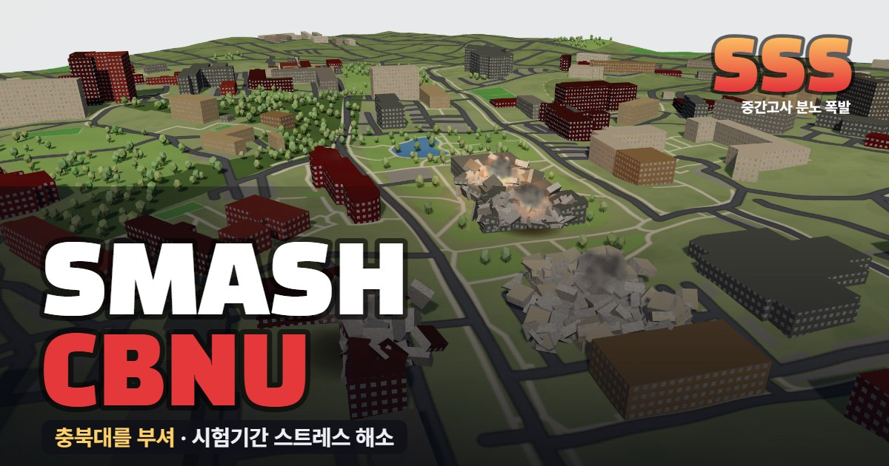

# SMASH CBNU · 충북대 부수기

충북대학교 개신캠퍼스와 그 둘레 동네를 3D로 부수는 브라우저 게임입니다. 중간·기말고사 스트레스를 풀려고 만들었습니다.

학교와 관계없는 비공식 팬 게임입니다. Hong-Iron 님의 [SMASH KMU](https://hong-iron.github.io/SMASH-KMU/)와 [SMASH 대학교](https://hong-iron.github.io/SMASH/) 시리즈를 보고 따라 만들었고, 코드는 처음부터 새로 짰습니다.

**바로 하기:** https://jjjjjjong.github.io/SMASH-CBNU/

## 하는 법

- 도구를 고르고 건물이나 땅을 누르면 부서집니다. 숫자 키 1~6으로도 도구를 바꿀 수 있습니다. 마우스를 올리면 도구가 미치는 범위가 주황색 원으로, 건물 이름이 커서 옆에 나옵니다.
  - 폭탄: 화면 옆에서 던진 폭탄이 날아가 터집니다. 가까운 조각은 더 잘게 쪼개지고, 땅에는 구덩이가 생깁니다.
  - 배트: 거대한 배트(×0.5~×3, 약 18~110 m)를 휘둘러 덩어리를 날립니다. 날아가는 조각을 또 치면 공중 콤보, 70 m 넘게 날아가면 홈런입니다.
  - 레이저: 화면을 끌어 선을 그으면 하늘이 어두워지며 충전한 뒤, 세 겹의 빔이 그 선을 훑습니다. 지나가는 곳마다 연쇄 폭발이 일어나고 양옆 건물이 튕겨 나가며, 땅에는 녹아 빛나는 홈이 남습니다.
  - 운석: 카메라가 떨어지는 운석을 따라가다가, 부딪히는 순간 느린 화면으로 보여 줍니다. 반경 92 m가 날아가고 큰 구덩이와 그을음이 남습니다.
  - 지진: 누른 곳이 진원입니다. 규모 4.0~10.0을 고르면 옆에 진도가 나옵니다. 땅이 출렁이고 갈라지며, 규모가 크면 1층이 주저앉아 건물이 통째로 무너집니다.
  - 핵폭탄: 떨어지는 핵폭탄을 따라가다, 터지는 순간 섬광과 충격파 돔, 버섯구름이 나옵니다. 반경 380 m 안이 날아가고, 폭음은 빛보다 조금 늦게 도착합니다.
  - 운석과 핵폭탄 연출은 화면을 누르거나 Esc로 건너뜁니다.
- 부술수록 랭크가 오르고 점수가 쌓입니다. 건물 하나를 다 무너뜨리면 화면에 이름이 뜹니다.
- 땅을 계속 파면 화면 아래에 구덩이 깊이와 지구 반대편이 어디인지 나옵니다.
- 되돌리기(Ctrl+Z)는 한 번에 하나씩, 전부 복구는 처음 상태로 돌아갑니다.
- **밤** 버튼이나 N 키를 누르면 밤이 됩니다. 별이 뜨고 창문에 불이 켜집니다.
- 화면 조작: 끌기는 돌리기, 오른쪽 끌기는 옮기기, 휠은 확대입니다. `H` 처음 시점, `T` 위에서 보기. 휴대폰에서는 한 손가락으로 돌리고 두 손가락으로 옮기거나 확대하며, 도구는 화면 아래에 있습니다.

## 데이터와 출처

- 캠퍼스 경계, 건물 모양과 층수, 도로, 녹지, 나무: © [OpenStreetMap](https://www.openstreetmap.org/copyright) 기여자 ([ODbL](https://opendatacommons.org/licenses/odbl/)). `data.js`도 이 데이터를 가공한 것이라 ODbL을 따릅니다.
- 땅 높이: [AWS Terrain Tiles](https://registry.opendata.aws/terrain-tiles/) (terrarium 형식, SRTM 기반).
- OpenStreetMap에 층수가 적힌 캠퍼스 건물은 156동 가운데 85동입니다. 나머지는 면적에 따라 높이를 어림했습니다.
- 건물 겉모습(벽돌, 석재, 유리, 창문)은 실제 사진이 아니라 코드로 그린 일반 재질이고, 건물마다 재질은 무작위로 골랐습니다.

## 만든 방법

- 3D는 three.js r160(CDN), 소리는 Web Audio로 합성합니다. 소리 파일은 없습니다.
- 페이지는 `index.html` 하나와 데이터 `data.js`뿐입니다. 빌드 과정 없이 그대로 GitHub Pages에 올라갑니다.
- 건물 겉모습은 셰이더로 그립니다. 건물마다 벽돌·석재·콘크리트·유리·베이지·아파트·주택·비닐하우스 가운데 하나를 고르고, OpenStreetMap 층수로 층 높이를 정합니다. 창틀, 1층 받침, 처마 띠, 옥상 난간이 붙고, 유리에는 하늘이 비칩니다.
- 데이터 다시 만들기 (`requests`, `numpy`, `Pillow` 필요):
  1. `python tools/fetch.py 6705106 raw` — 캠퍼스 경계(OSM relation 6705106), 둘레 약 200 m의 건물·도로·녹지, 고도 타일을 `raw/`에 받습니다.
  2. `python tools/build_data.py raw data.js` — 지역 좌표(미터)로 바꾸고, 겹쳐 저장된 건물을 합치고, 땅 높이를 정리(빈칸 메우기, 위성 고도에 찍힌 건물 자국 지우기, 연못 수면 맞추기)한 뒤 `data.js`를 씁니다.
- 내 컴퓨터에서 하려면 이 폴더의 `run.bat`을 더블클릭하세요(http://localhost:8770). 직접 켤 때는 **이 폴더 안에서** `python -m http.server 8770`을 실행해야 합니다. three.js와 글꼴을 CDN에서 받으므로 인터넷이 필요합니다.
